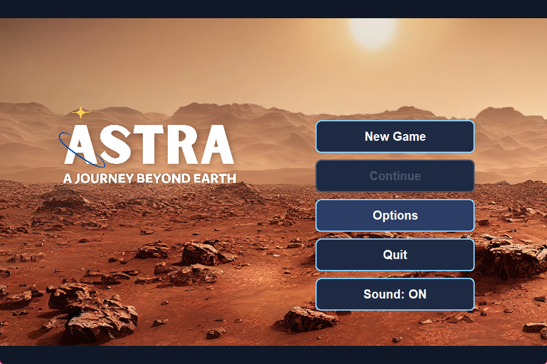
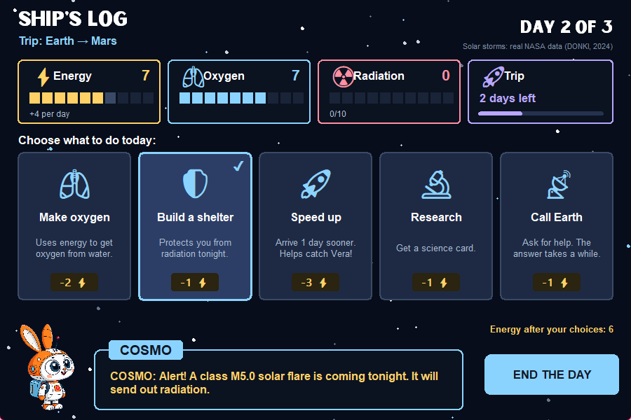
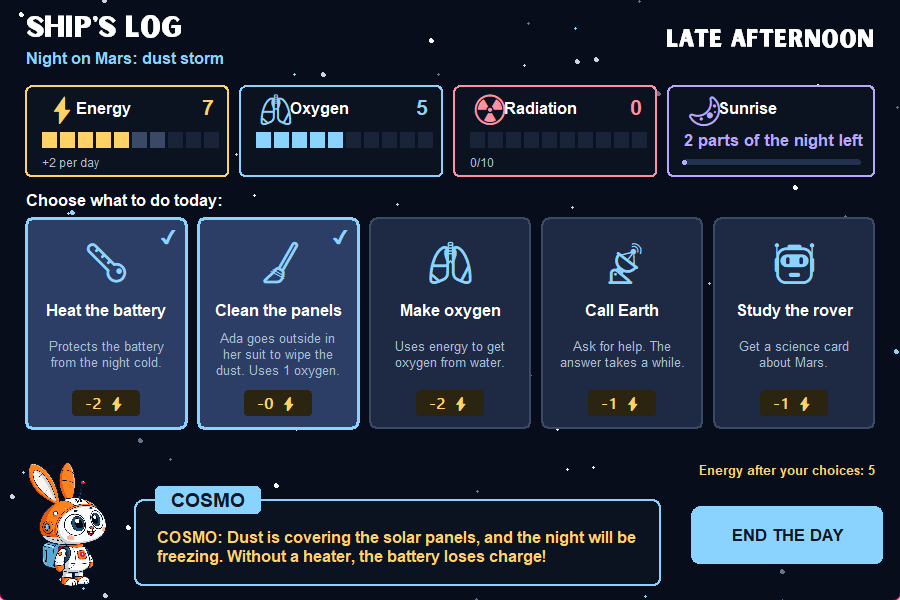
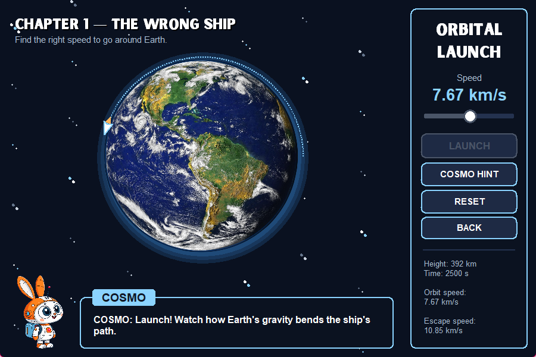
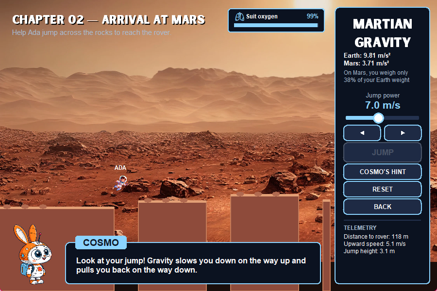
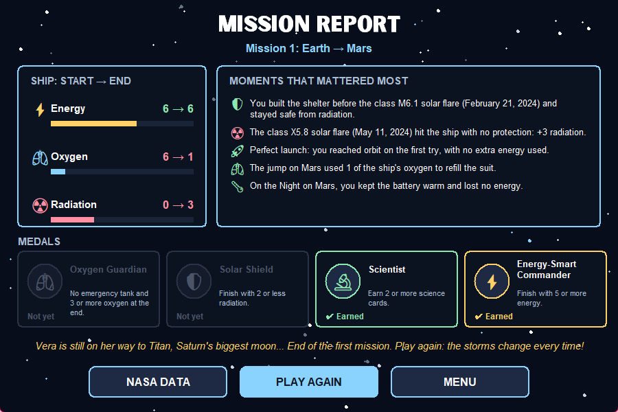
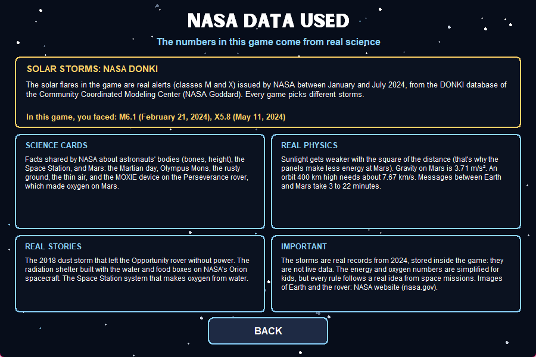

# ASTRA — A Journey Beyond Earth

**A story-driven space survival game for kids aged 7 to 12, built for the NASA Space Apps Challenge.**

Ada, a junior astronaut, has to chase a cargo ship to Mars after her little sister Vera sneaks on board. Her training ship was never built for a long trip, so **every day the player decides how to spend a small amount of energy** on oxygen, radiation protection, speed, or science. No choice is free, and every rule is based on how real missions work. The solar storms come from **real NASA data**.

**[⬇ Download for Windows](https://github.com/ACCajuela/seeuinstars/releases/latest)** · No installation needed · English and Brazilian Portuguese



*[Versão em português mais abaixo](#português)*

---

## How it answers the challenge

| The challenge asks for | What ASTRA does |
|---|---|
| Kids 7–12 manage a lunar or Martian outpost | The player runs Ada's **training ship** during the trip and a **camp on the surface of Mars** during a dust storm |
| Real trade-offs between life support, radiation protection, energy, food, communication delay | **3 resources** (⚡ energy, 🫁 oxygen, 🛡 shelter) plus a ☢ radiation dose that never goes down. Every action costs energy, and energy is always scarce |
| No "safe" choice | Building a shelter costs energy you need for oxygen. Speeding up leaves you unprotected. Going outside to clean the panels uses suit oxygen |
| Communication delay | Messages to Mission Control **arrive one day later** in game, because radio travels at the speed of light (3 to 22 minutes each way to Mars) |
| Real NASA data | **71 real solar flare alerts** from NASA's **DONKI** database (2024) drive the radiation events. NASA facts and photos are used throughout |
| Replayability, learning from failure without punishment | Storms are drawn at random every game. Running out of oxygen triggers an emergency that **teaches instead of ending the game**. Medals invite the player to try other strategies |
| Clear attribution of the data | A **"NASA Data Used"** screen at the end lists every source, and says the data is **archived, not live** |

## How it plays

1. **Story:** short, illustrated dialogue with Ada, her sister Vera, and **COSMO**, Ada's AI assistant. Every science term is explained when it first appears.
2. **Orbital launch:** pick the right sideways speed to reach orbit. **Each failed launch costs 1 energy** in correction burns.
3. **Ship's Log, Earth → Mars (3 days):** each day, choose action cards. Then the night passes and a report shows what happened, with a **"Why?"** button that explains the real science.
4. **Mars gravity:** jump across Martian rocks to reach a rover. The **suit oxygen** drains over time and with every fall, and the ship pays to refill it.
5. **Night on Mars (the outpost):** a dust storm covers the solar panels and the night freezes the battery.
6. **Mission report:** how the ship ended, the moments that mattered most, medals, and the NASA data used.

| Ship's Log | Night on Mars |
|---|---|
|  |  |
| **Orbital launch** | **Mars gravity** |
|  |  |
| **Mission report** | **NASA data used** |
|  |  |

## The rules (and the real science behind them)

| Action or event | Effect in the game | Why (real basis) |
|---|---|---|
| ☀ Solar panels | +4 energy per day near Earth, +2 near Mars | Sunlight weakens with the square of the distance: Mars gets about 43% of the light Earth gets |
| 🫁 Make oxygen | −2 energy, +2 oxygen | The Space Station makes oxygen by splitting water with electricity |
| 😮‍💨 Breathing | −1 oxygen per night | A person breathes almost 1 kg of oxygen a day |
| 🛡 Build a shelter | −1 energy, blocks up to 2 radiation tonight | NASA's Orion spacecraft has a storm shelter built from the water and food bags |
| ☢ Solar flare | M-class below M5: +1, M5 or stronger: +2, X-class: +3 (minus what the shelter blocks) | Real alerts from NASA DONKI. Each flare class is 10 times stronger than the one before |
| 🚀 Speed up | −3 energy, arrive 1 day sooner | Engines use a lot of energy, and there are no refuelling stations in space |
| 📡 Call Earth | −1 energy, the answer arrives the next day (+2 energy tip) | Radio messages take up to 22 minutes each way between Earth and Mars |
| 🌪 Dust storm (Mars) | Dirty panels make 0 energy, unless Ada goes outside to clean them (−1 oxygen) | In 2018 a planet-wide dust storm left the Opportunity rover without power |
| 🌡 Freezing night (Mars) | Without a heater (−2 energy), the battery loses 3 energy | Martian nights can drop below −80 °C, and rovers spend power on heaters to survive |
| ⚠ Out of oxygen | The emergency tank refills 3 oxygen. Without a tank, COSMO turns everything off to make oxygen | Emergencies teach, they don't end the game |

## NASA data used

- **Solar storms:** [NASA DONKI](https://kauai.ccmc.gsfc.nasa.gov/DONKI/), the Space Weather Database Of Notifications, Knowledge, Information by the Community Coordinated Modeling Center (NASA Goddard). We downloaded the **solar flare (FLR) notifications from January to July 2024** through `https://api.nasa.gov/DONKI/notifications?type=FLR` and stored 71 M- and X-class alerts in [`data/donki_flares_2024.json`](data/donki_flares_2024.json), each with its date, class, and a link to the official alert. During the game, the report shows the date and class of every storm the player faced.
- **Science cards:** facts published by NASA about astronauts' bodies in microgravity (bone loss, getting taller), the International Space Station, and Mars (the Martian day, Olympus Mons, the rusty ground, the thin air, and the MOXIE experiment on the Perseverance rover, which made oxygen on Mars).
- **Real physics:** inverse-square law for sunlight, Martian gravity (3.71 m/s²), orbital speed at 400 km (about 7.67 km/s), light delay between Earth and Mars.
- **Images:** the photo of Earth and the rover image come from the NASA website (nasa.gov).

> The solar storm data is **archived (2024), not live**. Energy and oxygen numbers are simplified for kids, but every rule follows a real idea from space missions.

## Play it

### Windows (recommended)
1. Download **`ASTRA-windows.zip`** from the [latest release](https://github.com/ACCajuela/seeuinstars/releases/latest) and unzip it.
2. Double-click **`ASTRA.exe`**.
3. If Windows shows *"Windows protected your PC"*, click **More info → Run anyway**. The warning appears because the game is not signed with a paid certificate.

Progress and settings are saved in `%APPDATA%\ASTRA`.

### From the source code (Windows, macOS, Linux)
Requires Python 3.10 or newer.
```
pip install pygame-ce
python main.py
```
On macOS and Linux the game runs, but the Sunborn title font and some icons fall back to system fonts.

## For developers

```
python main.py --cenas                         # list chapters and scenes
python main.py --capitulo 2 --cena mars_night  # start at a scene
python main.py --diario travel_earth_mars      # open a Ship's Log directly
python -m core.mission                         # play the resource rules in the terminal
python test_mission.py                         # 54 tests (rules, story, save, report)
python tools/build_windows.py                  # build dist/ASTRA.exe and the release zip
```

| Folder or file | What it holds |
|---|---|
| `core/mission.py` | Ship resources and the daily rules |
| `core/engine.py`, `chapters/` | Story engine and the chapters (`story.json`) |
| `screens/mission_log.py` | Ship's Log screen (resource management) |
| `screens/mission_report.py` | Mission report and NASA data screen |
| `puzzles/` | Minigames (orbital launch, Mars gravity, and more) |
| `locales/` | All texts in English and Portuguese |
| `data/donki_flares_2024.json` | Real NASA DONKI solar flare alerts |

## Team

- **Briena Bertoni**: game design, story, visual identity, simulation
- **Ana Carolina Cajuela**: game engine, minigames, audio, localization

<!-- TODO (equipe): completar os créditos abaixo antes da entrega.
     - Autoria/ferramenta dos personagens, fundos e logo
     - Licença da fonte Sunborn
     - Narração da intro (gravação "Pale Blue Dot", de Carl Sagan): confirmar direitos ou trocar
-->

---

## Português

**ASTRA — Uma Jornada Além da Terra** é um jogo narrativo de sobrevivência espacial para crianças de 7 a 12 anos, feito para o NASA Space Apps Challenge.

A astronauta júnior Ada precisa perseguir uma nave de carga até Marte depois que a irmã, Vera, entra escondida nela. A nave de treino da Ada não foi feita para viagens longas, então **a cada dia a jogadora decide como gastar um pouco de energia**: oxigênio, proteção contra radiação, velocidade ou ciência. Nenhuma escolha é de graça, e cada regra segue o funcionamento de missões reais. As tempestades solares vêm de **dados reais da NASA**.

**[⬇ Baixar para Windows](https://github.com/ACCajuela/seeuinstars/releases/latest)**: baixe o `ASTRA-windows.zip`, extraia e clique duas vezes em `ASTRA.exe`. Se aparecer *"O Windows protegeu o computador"*, clique em **Mais informações → Executar assim mesmo**. O aviso aparece porque o jogo não tem assinatura digital paga.

**Como o jogo atende ao desafio:**
- **Posto avançado:** a nave de treino durante a viagem e um acampamento em Marte durante uma tempestade de poeira.
- **Trocas reais:** 3 recursos (⚡ energia, 🫁 oxigênio, 🛡 abrigo) e a ☢ dose de radiação, que nunca diminui. Toda ação gasta energia, e ela sempre falta.
- **Atraso na comunicação:** as respostas do Controle da Missão chegam no dia seguinte.
- **Dados reais da NASA:** 71 alertas de explosões solares do **DONKI** (2024), fatos da NASA nas cartas de ciência e imagens do site da NASA (nasa.gov).
- **Rejogabilidade sem punição:** tempestades sorteadas a cada partida, emergências que ensinam em vez de encerrar o jogo e medalhas para tentar outras estratégias.
- **Transparência:** a tela final "Dados da NASA usados" lista as fontes e avisa que os dados são arquivados, não ao vivo.

**Rodar pelo código-fonte:** `pip install pygame-ce` e depois `python main.py`.
